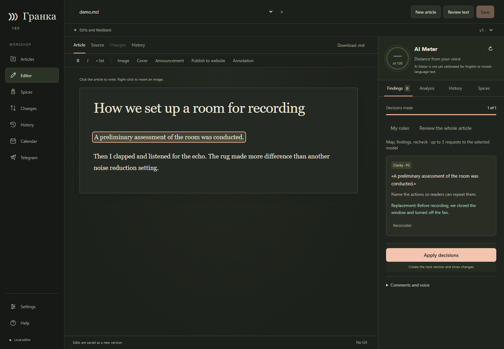
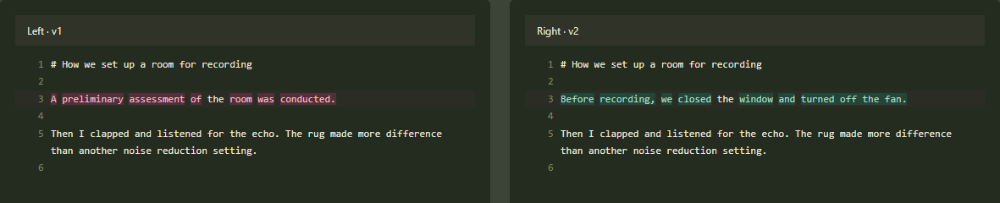

# Granka

[Русский](README.md) · [Your first edit](docs/FIRST_EDIT.en.md)

By **androman** · [androman.pro](https://androman.pro) · [Telegram](https://t.me/andromanpro1c)

A local Markdown workshop: edit articles, review AI suggestions, keep your own
wording, compare versions, add illustrations and prepare website or Telegram posts.
Your writing and version history stay in your configured folders. AI and publishing
services are contacted only for requested operations or explicitly confirmed schedules.

The name comes from the Russian printing term for a **galley proof**: a proof
prepared for review before publication.

[**Download Granka for Windows**](https://github.com/andromanpro/granka/releases/tag/v1.8.0)
· [Your first edit, step by step](docs/FIRST_EDIT.en.md)

## What changes when you edit a longer piece

After several rounds of editing, it is hard to remember why a sentence changed.
Granka puts the original quote, the reason and the proposed edit next to each
other. Accept the suggestion, write your own or keep the original.
**The text changes only when you apply your decisions.** Compare the new version
with the previous one, or restore older wording as a new version.

## When to use it

- **Articles and posts.** Make a draft more specific while keeping the way you write.
- **Technical write-ups.** Review suggestions one at a time and keep terminology
  and phrasing that matter to the argument.
- **Publication preparation.** Assemble text and media, preview the result and
  confirm delivery separately. Saving a draft does not publish it.

## Try it on one paragraph

Open a Markdown file or start a new article. Connect your own provider
for AI suggestions. Accept one edit, reject another, then choose
**Apply decisions** and open **Changes**.

**English support.** The editor and AI review work in English. AI Meter is
not calibrated for English or mixed-language text.

<!-- end-showcase -->

## Start

Use the Windows installer or portable archive. Run **Granka** and open its local
browser page. For a source checkout, install `requirements.txt` and run
`launch-granka.py` with Python 3.14. Use **New article** to create a blank draft,
an outline, your notes or a separately requested AI draft. Existing Markdown files
and folders can be connected through **Articles → Open file / Add folder**.

## Choose languages

Open **Settings → Languages**. Interface language is remembered in the current
browser and switches without reloading or discarding unfinished edits. Material
language and AI explanation language are separate settings; save them before
starting new jobs. For example, review an English article with Russian explanations.
Quotes, filenames and previous versions are not translated. Switching the interface
never sends a model request or translates an article.

AI Meter has not been calibrated for English or mixed-language texts. It therefore
shows unavailable scores, not a misleading zero. AI editorial review is still
available. Embedded help is translated; older screenshots and linked detailed
guides are in Russian. Unmapped server diagnostics retain their original detail.

## Review and retain control

Select **Review text**, inspect suggestions against exact quotes, and accept,
edit or reject them. **Apply decisions** creates a new version. **Changes** compares
saved versions; **History → Restore as new version** retains later history too.
**Spices** offers separate doses of irony, risqué humour, metaphors and allegories.
It produces suggestions first; you choose which edits to apply.

Codex uses your account sign-in; OpenRouter uses your API key and separate billing.
Select providers in Settings. Do not put credentials in your articles or screenshots.

## Schedule a Telegram post

1. Open the article's **Telegram** section. Prepare its text and attachments.
2. Choose create or update, then **Review before sending**. Check the exact snapshot.
3. Select **Schedule publication…**. Enter date, time and an explicit time zone.
4. Optionally limit allowed weekdays and hours. Check the delivery confirmation,
   then select **Confirm schedule**.

Saving a draft or assigning a calendar date does not authorize delivery. The queue
uses a fixed reviewed snapshot; later draft edits do not replace it. View or cancel
jobs under **Calendar → Scheduled publications** or in Telegram's queue section.
Rescheduling requires another confirmation. Once sending starts, it cannot be
recalled with Cancel.

Keep the computer awake and Granka running. The browser tab may be closed.
A fixed UTC offset does not follow daylight saving changes; named zones require
a local IANA time-zone database. More than one minute late means **Time missed**,
not automatic catch-up. An unknown result requires checking the channel: Granka
does not resend blindly. A rejection also pauses the job rather than retrying.
Successful delivery produces a receipt and post link.

This version does not provide an always-on server, automatic wake-up, automatic
rollover to another time window, cross-post spacing or delayed website publishing.

## Privacy

Local editing and the calendar work without AI. Requested AI jobs may transmit the
article, personal rules and selected author examples to your configured provider.
Confirmed publishing transmits the reviewed material to its chosen destination.
No personal articles, tokens or machine configuration are included in distributions.
