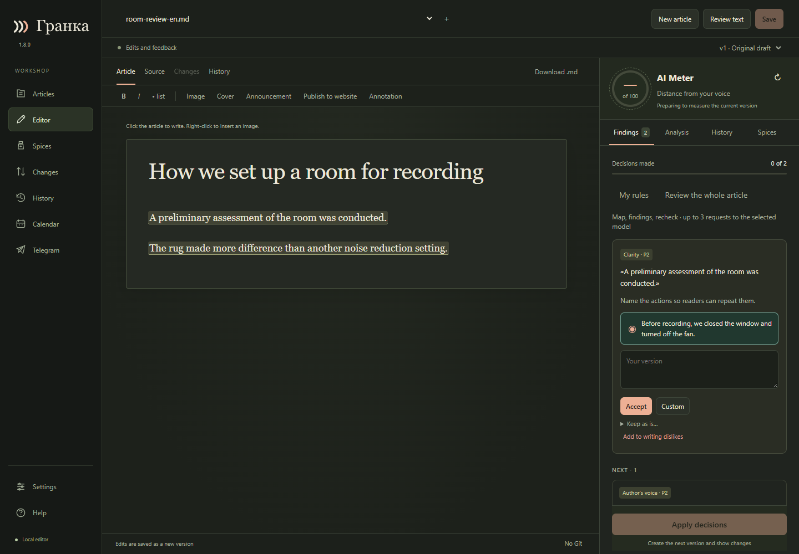
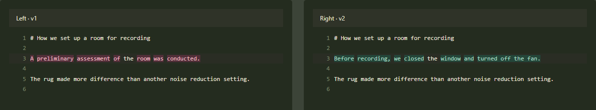
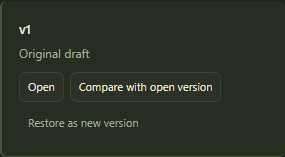

# Worked example: accept one edit and keep the author’s line

[Русский](CASE-EDITORIAL-REVIEW.md) · [Your first edit](FIRST_EDIT.en.md)

**Scenario.** A draft about recording sound opens with a vague sentence.
The next sentence carries an observation in the author’s own voice. The
editor suggests changing both. Make the first sentence concrete, keep the
second, and verify the difference between versions.

**Before you start.** Download the [English sample article](../examples/room-review-en.granka.json)
(on GitHub, use the download raw file button). Save it to a separate folder
and open it with **Articles → Open file…**. The two sample suggestions are
already there; do not choose **Review text**. No model or API key is needed.
To repeat the exercise, start with a fresh copy.

## 1. Decide what to change

For “A preliminary assessment of the room was conducted”, accept
“Before recording, we closed the window and turned off the fan”. That
tells the reader what the author did instead of naming a generic process.

The second suggestion replaces “The rug made more difference than another
noise reduction setting” with “The rug reduced the echo”. Choose
**Keep as is… → Fits here**. The comparison with noise reduction is part of
the observation. Neither accepting nor rejecting a suggestion changes the
article at this point.

## 2. Apply your decisions and compare versions

Choose **Apply decisions**, then open **Changes**. If needed, select `v1`
on the left and `v2` on the right. Only the first sentence should change.
The line about the rug should stay as written.

## 3. Verify that you can restore the original

Open **History**, find `v1` and choose **Restore as new version**. This is
a test on the sample copy. Granka creates `v3` with the original text;
`v2` remains available for comparison.

**Expected result.** There is exactly one replacement in `v2`. Version
`v3` contains the original text, and both earlier versions are retained.
The article stays local: none of these steps sends it to a website or Telegram.
