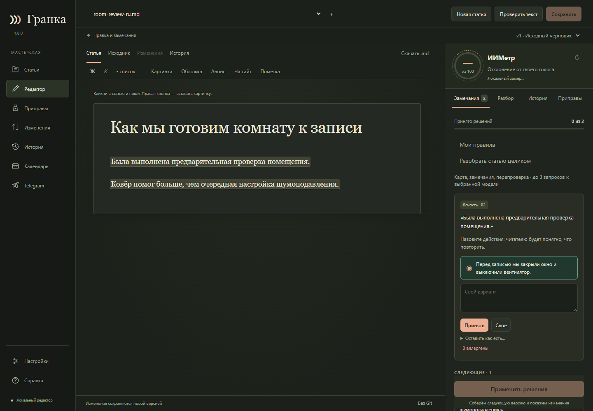
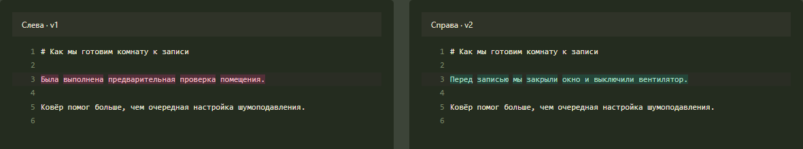
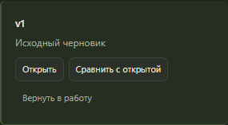

# Практический кейс: принять одну правку и сохранить авторскую фразу

[English](CASE-EDITORIAL-REVIEW.en.md) · [Первая правка](FIRST_EDIT.md)

**Ситуация.** В черновике о записи звука первая фраза расплывчата, а
следующая передаёт наблюдение автора. Редактор предлагает поменять обе.
Задача — сделать первую конкретнее, оставить вторую и проверить разницу
между версиями.

**Перед началом.** Скачайте [русскую учебную статью](../examples/room-review-ru.granka.json)
(на GitHub — кнопка скачивания исходного файла). Сохраните её в отдельную
папку и откройте через **«Статьи → Открыть файл…»**. В файле уже два
учебных замечания: **«Проверить текст»** нажимать не надо, ключ и модель
не нужны. Если проходите кейс повторно, возьмите свежую копию.

## 1. Решите, что менять

У фразы «Была выполнена предварительная проверка помещения» примите
замену: «Перед записью мы закрыли окно и выключили вентилятор». Она сообщает,
что именно сделал автор, вместо общего названия действия.

Вторая правка заменяет «Ковёр помог больше, чем очередная настройка
шумоподавления» на «Ковёр уменьшил эхо». Оставьте исходную фразу:
**«Оставить как есть… → Уместно здесь»**. Сравнение с шумоподавлением —
часть наблюдения, а не лишние слова. Ни принятие, ни отказ сами по себе
ещё не меняют текст.

## 2. Примените решения и сравните версии

Нажмите **«Применить решения»**, затем откройте **«Изменения»**. Слева
выберите `v1`, справа — `v2`, если они ещё не выбраны. Первая фраза
должна измениться; строка про ковёр — остаться как была.

## 3. Проверьте, что исходный текст можно вернуть

Откройте **«История»**, найдите `v1` и нажмите **«Вернуть в работу»**.
Это проба на учебной копии. Гранка создаст `v3` с исходным текстом;
`v2` с правкой останется доступна для сравнения.

**Что должно получиться.** В `v2` ровно одна замена, в `v3` снова исходный
текст, обе прежние версии сохранены. Статья осталась локальной: ни один
из этих шагов не отправляет её на сайт или в Telegram.
