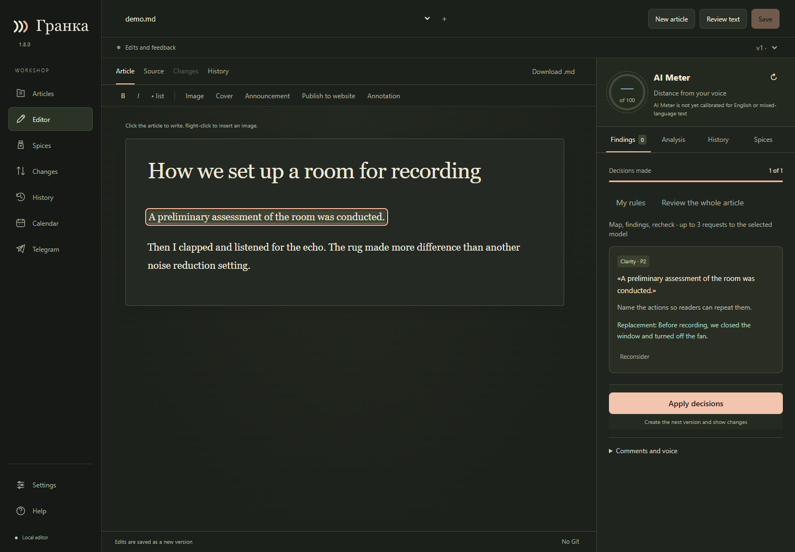
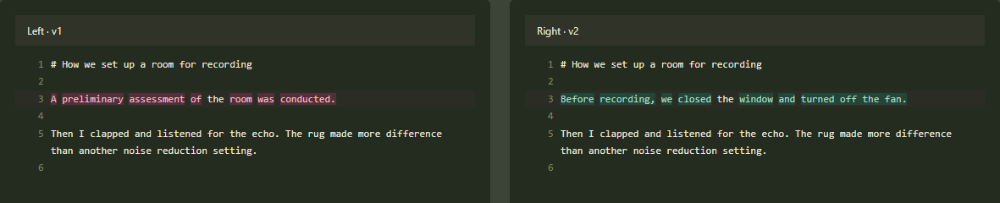

# Your first edit in Granka

[Русский](FIRST_EDIT.md) · [English overview](../README.en.md)

1. Go to **Articles → Open file** and choose a Markdown draft. Or choose
   **New article** to start with a blank page.
2. Open **Settings → Languages**. The interface, the material and AI explanations
   have separate settings. Changing the interface does not translate your article.
3. To get AI suggestions, connect your own provider and request a review. The
   screenshot below shows a sample article after accepting a prewritten suggestion
   but before applying it to the text.

4. Read the suggestion against its original quote. Accept the edit, write your
   own replacement or reject it. Your original text stays unchanged until you apply
   the decisions.
5. Choose **Apply decisions** to create a version. Compare it with the previous
   text. You can restore an older version as a new one from **History**.

Publishing is a separate action. Saving the article or applying edits does not
send it to a website or Telegram. AI Meter is not calibrated for English text;
you can still request an editorial review in English.
