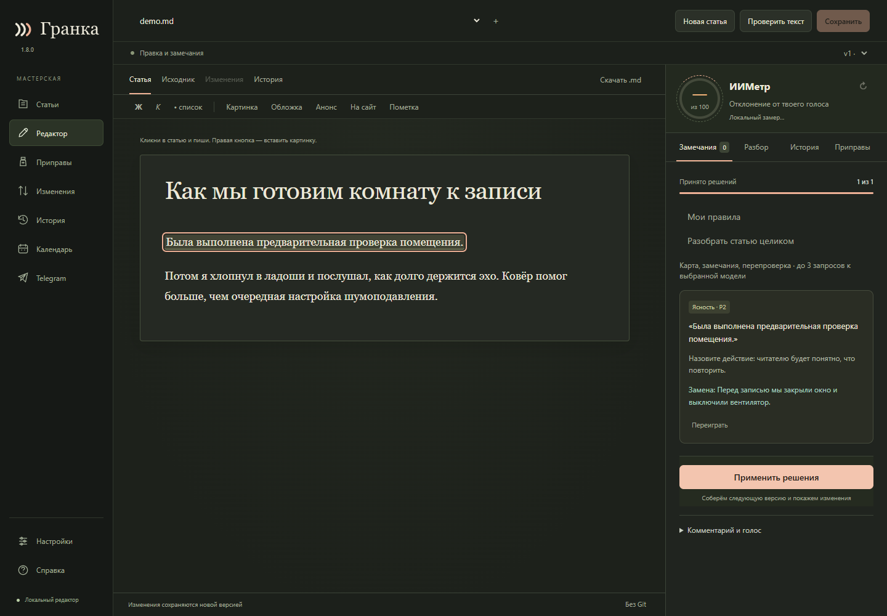
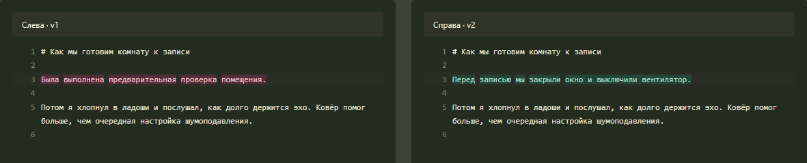

# Первая правка в Гранке

[English](FIRST_EDIT.en.md) · [Руководство пользователя](USER-GUIDE.md)

1. Откройте **«Статьи» → «Открыть файл»** и выберите черновик Markdown.
   Если файла ещё нет, нажмите **«Новая статья»** и начните с пустого текста.
2. Откройте **«Настройки» → «Языки»**. Интерфейс, материал и язык замечаний
   задаются отдельно. Язык интерфейса не переводит статью.
3. Чтобы получить замечания ИИ, подключите своего провайдера и запустите проверку
   текста. На снимке ниже — учебный пример: предложение уже принято, но ещё не
   применено к статье.

4. Прочитайте замечание рядом с исходной фразой. Примите замену, напишите свою
   или отклоните предложение. До применения решений исходный текст не меняется.
5. Нажмите **«Применить решения»**. Гранка создаст версию; сравните её с исходной.
   Если правка не подошла, восстановите старый текст как новую версию из истории.

Подготовка к публикации — отдельное действие. Сохранение статьи и применение
правок не отправляют материал на сайт или в Telegram.
