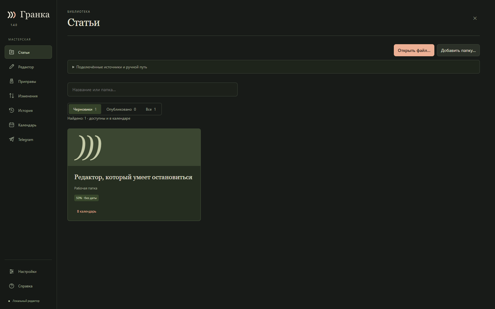
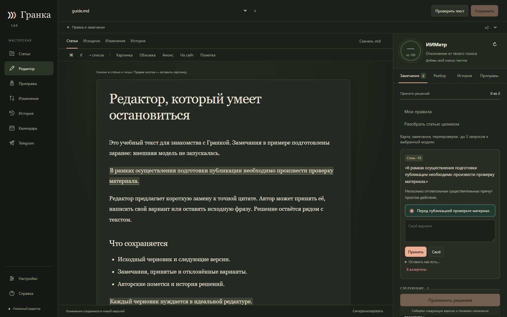
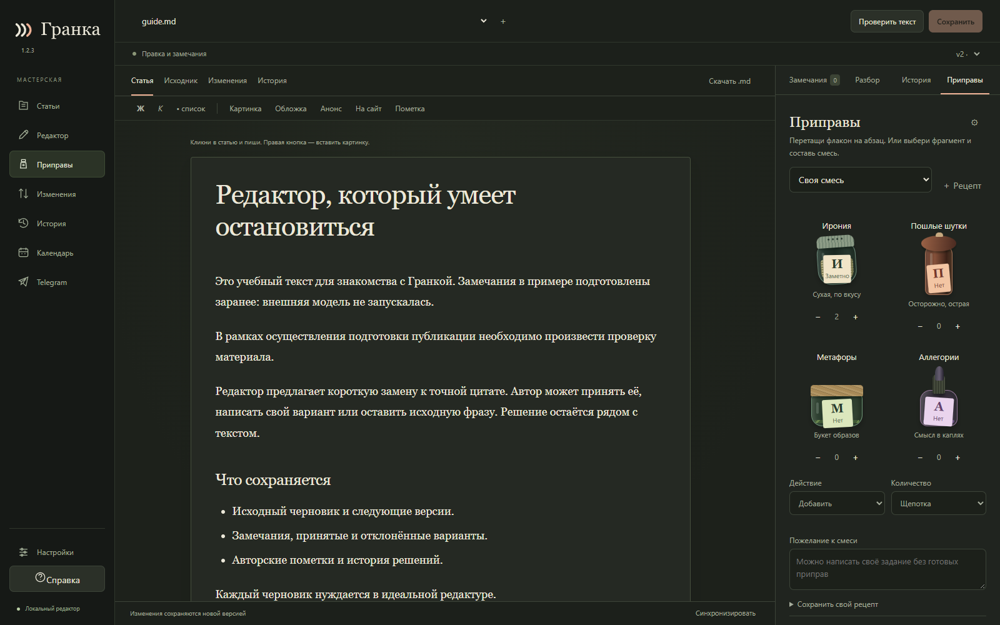
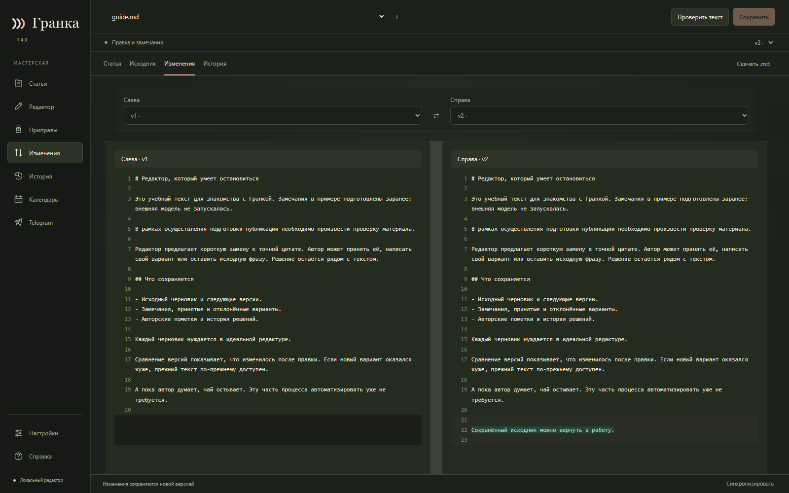
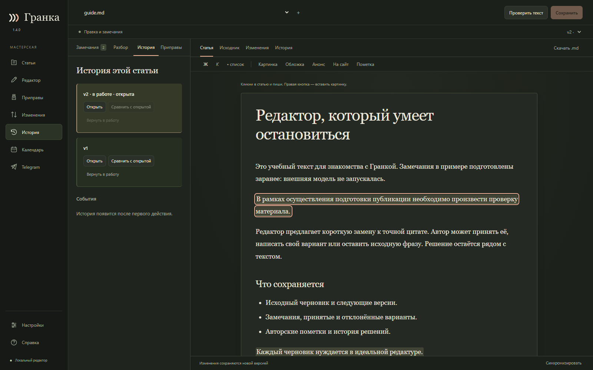
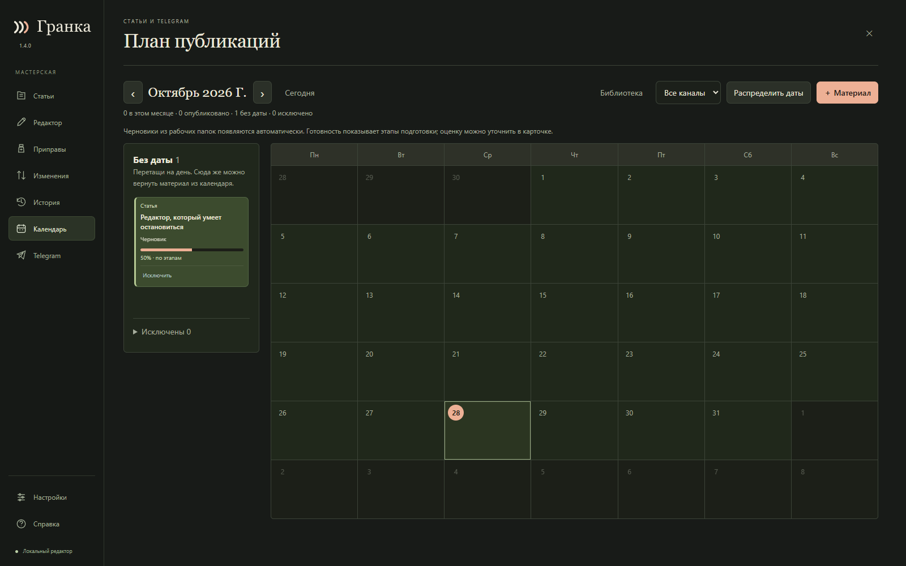
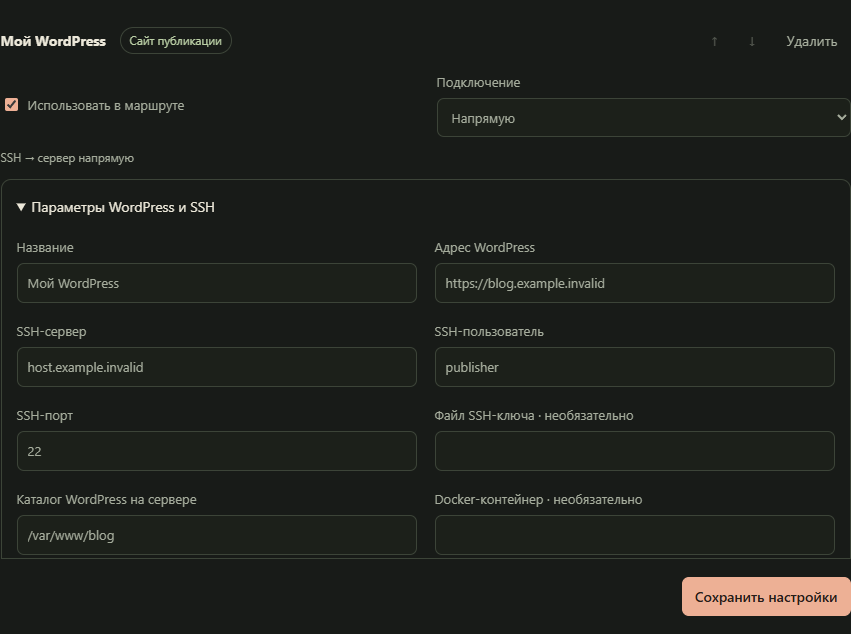
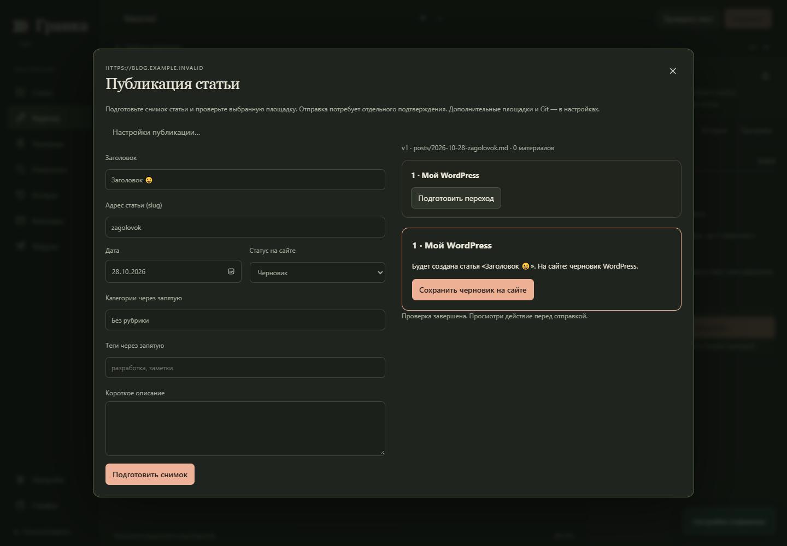
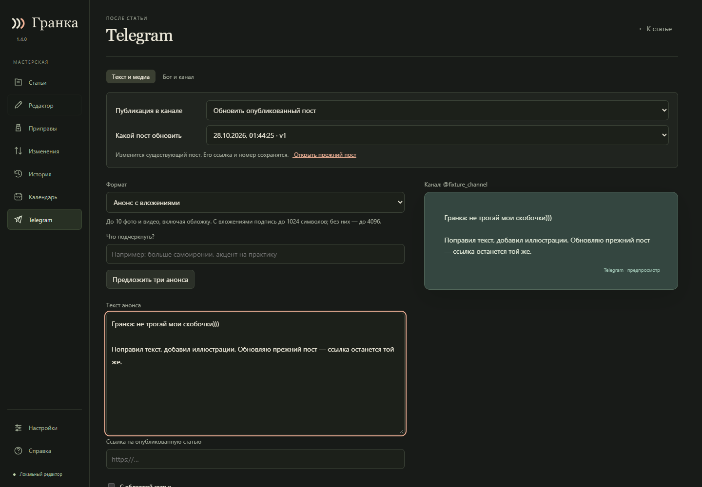
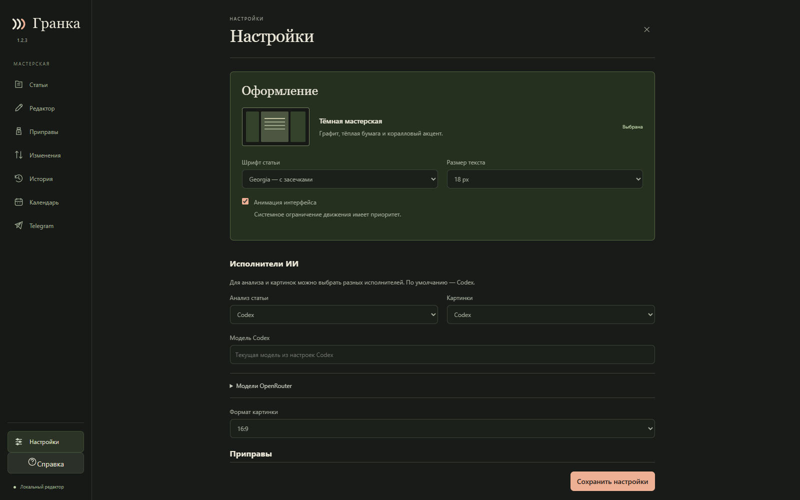

# Работа в Гранке

Справка для Гранки 1.7.2. На снимках — учебная статья; часть снимков сделана
в 1.3.0. Мастер новой статьи, корпус ИИМетра и корзина описаны ниже.

## Создать статью

Нажмите **Новая статья** в библиотеке или верхней панели. Введите название,
при необходимости — аудиторию и цель. Выберите пустой черновик, разделы,
свои заметки или **Заготовка с ИИ**. Первые три варианта работают локально.

Для заготовки с ИИ укажите факты и заметки, объём и авторский профиль.
Переключатель **Писать в моём стиле** добавляет личные правила и примеры
из подключённого корпуса. Можно выбрать приправы и разовый рецепт.
**Написать заготовку** запускает выбранного исполнителя; запрос использует
его подписку или тариф. Дождитесь результата и при необходимости исправьте текст.

На последнем шаге проверьте папку и имена Markdown и разметки.
**Создать статью** сохраняет оба файла. Генерация сама не создаёт статью
и не назначает дату публикации. Прежние файлы не перезаписываются.

## Открыть статью

В меню **Статьи** выберите **Открыть файл…** или **Добавить папку…**.
Гранка работает с Markdown. Рядом с исходником появляется файл
`.granka.json`: в нём хранятся версии, замечания и решения.
Подключённые источники запоминаются локально.

Фильтры **В работе** и **Опубликовано** относятся к факту выпуска.
Подтверждение берётся из квитанции публикации, метаданных или настроенной
связи с адресом статьи. Сходство названий и папка `_ready` этого не подтверждают.
У опубликованного материала можно открыть готовую страницу.

## Написать и сохранить

В меню **Редактор** доступны оформленный текст и **Исходник**.
Пишите прямо в статье; **Сохранить** или `Ctrl+S` создаёт новую версию.
Переход к другой статье с незавершённой правкой предложит сохранить её,
отказаться от ввода или остаться. Переход в справку сохраняет черновик в редакторе.

**Проверить текст** запускает выбранного ИИ-исполнителя. Прочитайте замечание
к точной цитате и выберите замену, свой вариант или отказ с пояснением.
Команда **Применить решения** собирает новую версию. До неё принятая карточка
не переписывает абзац. Кодекс требует входа в свой аккаунт, OpenRouter —
своего ключа; запросы могут расходовать подписку или средства выбранного сервиса.

## Добавить приправу

Откройте **Приправы**. Ирония, пошлые шутки, метафоры и аллегории имеют
отдельную дозировку. Можно перетащить флакон на абзац, выбрать абзац кнопкой,
использовать выделение или всю статью. Кнопка **Приправить** использует
всю выбранную смесь. Свободное пожелание работает без готового рецепта.

Сначала появляются предложения. Выберите подходящие, поправьте формулировки
при необходимости и нажмите **Применить выбранное**. Исходник останется
в истории. **Сохранить свой рецепт** запоминает смесь; общие авторские
правила от этого не меняются. При несохранённом вводе сначала сохраните статью.

## Настроить ИИМетр

В панели ИИМетра выберите папку со своими текстами для сравнения авторского
голоса. Профиль строится локально; исходники корпуса не переписываются.
Для следующего измерения читается актуальный список файлов. Если папка
пуста, недоступна или не содержит подходящих текстов, Гранка сообщает причину.
Без корпуса остаются локальные текстовые признаки.

Оценка ИИМетра — редакторский ориентир, а не доказательство машинного
авторства. После изменения текста запустите измерение повторно.

## Сравнить и вернуть

В **Изменениях** выберите левую и правую версии. Можно поменять их местами.
Само сравнение ничего не записывает в статью.

В **Истории** откройте нужное сохранение и нажмите **Вернуть в работу**.
Гранка создаст новую вершину истории с прежним текстом; более поздние
сохранения тоже останутся. Здесь «в работе» означает текущую редакцию,
а не отсутствие опубликованной статьи.

## Разобраться со статусом

Верхняя строка показывает **Опубликовано на сайте**, **Опубликовано в Telegram**
или оба канала, когда есть подтверждение. Выпуск на предпросмотре или стейдже,
сохранённый черновик WordPress и подготовленный Telegram-пост публикацией
не считаются. Неоднозначная отправка тоже не становится успешной автоматически.

Если после выпуска внесены изменения, появляется **есть правки**.
Адрес и известная опубликованная версия доступны в подсказке строки.
Ранее опубликованный материал остаётся опубликованным, пока вы готовите
его следующую редакцию. Отдельные редакторские состояния не переписываются.

## Убрать статью и восстановить

В библиотеке перенесите ненужный материал в **Корзину**. Гранка покажет
затрагиваемые файлы; при активном задании перенос недоступен.
Копии проверяются до удаления оригиналов. Общие материалы других статей
не удаляются, публикации на сайте и в Telegram остаются на своих местах.

Откройте корзину для восстановления. Занятые пути не перезаписываются:
сначала устраните конфликт. Окончательная очистка — отдельное действие
с подтверждением. После неё восстановление из корзины невозможно.

## Разложить по датам

**Календарь** показывает рабочие материалы и подтверждённые публикации.
Откройте карточку, назначьте дату и сохраните. Планирование само не запускает
ИИ и не отправляет посты. Предпросмотр распределения дат можно изучить до применения.

## Подготовить сайт

Кнопка **На сайт** в редакторе открывает параметры и снимок статьи:
заголовок, адрес, дату, рубрики, метки, краткое описание и статус WordPress.
Для уже выпущенной статьи кнопка называется **Обновить на сайте**.

Откройте **Настройки → Публикация на сайт → Добавить WordPress**. Укажите
название и адрес сайта, SSH-сервер и пользователя, каталог WordPress.
Если используется отдельный SSH-ключ, укажите путь к его файлу. Пустой путь
использует обычную настройку SSH/ssh-agent. На сервере должен быть установлен
WP-CLI; это подключение по SSH, не пароль администратора WordPress.

Для одного сайта NAS, стейдж и Git не нужны. Включите публикацию, сохраните
настройки и вернитесь к статье. Подготовка снимка сохраняет текст,
обложку, картинки и видео локально; **Подготовить переход** только проверяет
сайт и показывает, будет создан новый пост или обновлён существующий.
Отправка начинается отдельной кнопкой подтверждения. Статус **Черновик**
сохраняет черновик WordPress, **Опубликовано** делает статью доступной читателям.

Если нужны промежуточные проверки, добавьте ещё площадки и расположите их
стрелками. Последняя включённая площадка — основной сайт, остальные —
предварительные. Их страницы доступны на соответствующих серверах;
после просмотра подтвердите переход к следующей. Галочка **Использовать
в маршруте** позволяет пропустить площадку, сохранив её настройки.
На любой площадке внешняя правка WordPress останавливает перенос.
Изменение адреса или порядка после подготовки требует нового снимка.

Если внешнему серверу нужен прокси, откройте **Настройки → Публикация на сайт**.
Для каждого сайта выберите **Напрямую**, **Системный прокси** или **Указать прокси**.
Там же показан адрес, найденный в системе. Локальная площадка обычно использует
прямое подключение. Сохранение настроек ничего не публикует; кнопка
**Подготовить переход** проверяет сервер и показывает предстоящую операцию.

В **Хранение снимков в Git** можно включить дополнительную копию в своём
репозитории. Он должен быть уже создан, с origin, нужной веткой и авторством.
Git включается отдельно; Гранка не создаёт его автоматически и не требует
GitHub или Gitea для обычной отправки в WordPress.

## Подключить Telegram

В разделе **Telegram → Бот и канал → Публикация** выберите режим:

- **От имени канала — через бота** — Гранка отправляет пост в выбранный канал.
  Личный профиль владельца не используется. Название канала видно
  в предпросмотре и перед окончательной отправкой.
- **Вручную в Telegram** — Гранка готовит текст, но ничего не отправляет.
  Скопируйте текст, добавьте вложения и выберите отправителя в самом Telegram.
  Токен бота для этого режима не нужен.

Нажмите **Сохранить настройки Telegram**. В ручном режиме отправка через
бота отключена, в том числе из вкладок с ранее подготовленным постом.

Для отправки через бота сохраните его токен и `@имя_канала`, затем нажмите
**Проверить доступ**.
Для закрытого канала нужен числовой идентификатор. Проверка соединения
не отправляет сообщения. Токен хранится в личных настройках или отдельном
файле; не вставляйте его в статью, снимки экрана или переписку.

Создайте бота командой `/newbot` у официального [BotFather](https://t.me/BotFather),
затем добавьте его администратором своего канала с правом публикации сообщений.
Право удаления постов для нынешней отправки не нужно.
Историю оформления старых постов можно изучить по публичной ленте или
[экспорту Telegram Desktop](https://telegram.org/blog/export-and-more).
Bot API не предоставляет загрузку всей прежней истории канала.

**Анонс с вложениями** — короткая подпись и фотографии/MP4. Ссылка считается
вместе с подписью: до 1024 символов с медиа, до 4096 без него. Ролик ограничен
50 МБ; общий размер одной отправки тоже 50 МБ, в альбоме до 10 файлов.

**Статья с медиа** — отдельный черновик с изображениями и видео между
абзацами. Добавляйте каждое медиа отдельным блоком. Отображение зависит
от поддержки Rich Messages клиентом Telegram. Обычная подпись к ролику
не требует этого формата.

В поле **Публикация в канале** выберите действие. Если Гранка уже отправляла
эту статью в выбранный канал, по умолчанию стоит **Обновить опубликованный пост**.
Укажите прежнюю публикацию: её ссылка и номер сохранятся, а текст и медиа
заменятся проверенным снимком. Для альбома сохраняется число вложений;
изменение его состава требует отдельного нового поста.

**Создать новый** явно создаёт ещё одну публикацию. Рядом появляется
предупреждение, если статья уже выходила в этом канале. История доступна
только для отправок, выполненных Гранкой в том же профиле; произвольный
старый пост из Telegram автоматически не загружается.

Отправка проходит в два шага, номер текущего шага показан над кнопками:

1. **Проверить перед отправкой** фиксирует текст, файлы, канал и выбранное
   действие и открывает окончательный предпросмотр. Пост ещё не отправлен.
2. Проверьте предпросмотр и нажмите **Опубликовать в «имя канала»** или
   **Обновить опубликованный пост**. Эта кнопка отправляет пост в Telegram.

После проверки фокус переходит к пояснению второго шага. При неизвестном
исходе повтор блокируется: сначала посмотрите канал. Ошибка обновления
не создаёт новый пост.

Два окна одного профиля не могут одновременно отправить снимки этой статьи:
работает межпроцессная блокировка и проверка актуальности истории.
После отправки из другого окна устаревший снимок потребуется подготовить заново.
Кнопки **← К статье** в шапке и внизу формы возвращают в редактор;
незавершённый текст анонса остаётся в этом браузере.

Сайт и Telegram — отдельные внешние операции. Подготовьте обе версии заранее,
проверьте итоговую ссылку сайта и наличие бота. Успешный выпуск в один канал
не означает успех второго.

## Настроить рабочее место

В **Настройках → Оформление** выбираются шрифт и размер чтения, можно
отключить движение. Оформление сохраняется в текущем браузере.
Здесь же настраиваются ИИ-исполнители и маршруты подключения к сайту.
Маршруты и параметры ИИ сохраняются вместе с проверкой ревизии: чужие изменения
из второго окна не перезаписываются. Для расширенного подключения путей,
WordPress и голоса есть [описание конфигурации](CONFIGURATION.md).

Установка, переносимая версия, обновление и удаление описаны в
[руководстве Windows](WINDOWS.md). Разбор статьи целиком — в
[описании глубокого разбора](DEEP-REVIEW.md).
